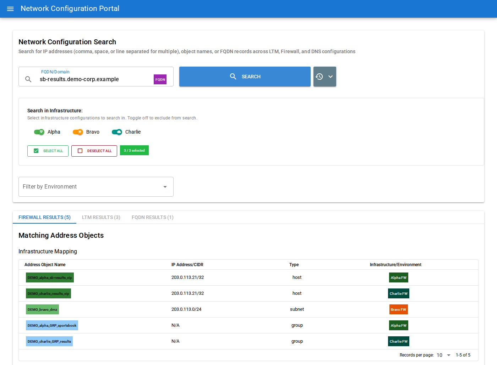
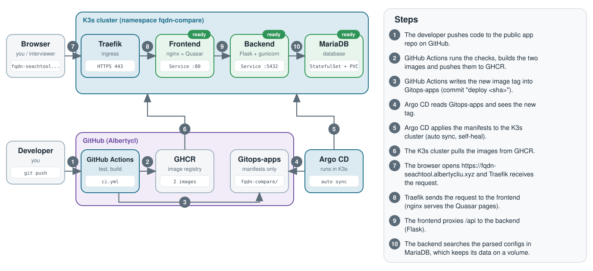

# FQDN Search in multiple FW and LTM comparing

**Live demo:** https://fqdn-seachtool.albertycliu.xyz (made-up demo data, no login)

A search page for network engineers (the page calls itself "Network Configuration Portal"): type an IP address, a domain name or an object name, and see its DNS records, its load-balancer entries and the firewall rules that touch it.



## What it does

- **Enter an IP:** it shows the FQDN(s) recorded for that IP, the private and the public address when a firewall NAT rule links them, and whether the IP exists anywhere in the load balancers (F5 LTM virtual servers, pools and nodes). Partial IPs and CIDR ranges work too.
- **Enter an FQDN (public or private) or an object name (3 characters or more):** it gives you the IP(s) from the DNS records, then shows the LTM virtual servers and the firewall address objects, groups, policies and NAT rules for them.
- **Firewall matching is smart:** a single address (`/32`) is found inside a wider subnet (`/24`) rule.
- **UltraDNS:** public FQDNs and their IPs come from UltraDNS records, kept in a database table that the app only reads. This demo uses made-up records instead.
- Can update itself every day and keeps a run history page. The demo runs on made-up data only (documentation IP ranges, `demo-*.example` names).

## How it works



Code goes to GitHub, GitHub Actions builds the images and updates the [Gitops-apps](https://github.com/Albertycl/Gitops-apps) repo, and Argo CD deploys the change to a K3s cluster by itself.

## SRE skills this shows

- **GitOps and CI/CD:** GitHub Actions, GHCR, Argo CD with auto sync and self-heal.
- **Rollback:** `git revert` of the "deploy" commit in Gitops-apps.
- **Containers:** one Dockerfile per component, Docker Compose, a switch between a bundled and an external database, a database health check.
- **Configuration:** every setting and address comes from environment variables, no default password, no secrets in Git.
- **Kubernetes:** StatefulSet with a volume, Traefik ingress, readiness checks.
- **Operations:** an optional daily update job and a run-history page.

## Run it locally

Needs Docker with the Compose plugin.

```bash
cp .env.example .env            # set DB_PASSWORD (letters and digits)
docker compose --profile bundled-db up -d --build
./demo/load-demo-data.sh        # loads the made-up demo rows (wait about a minute after the first start, until the database is ready)
```

Then open `http://<server-ip>:5434`. Stop with `docker compose --profile bundled-db down`.

## More

[Full details](docs/DETAILS.md): install on Kubernetes, CI/CD, monitoring and known limits.
